<!-- Please do not change this logo with link -->

<a target="_blank" href="https://www.microchip.com/" id="top-of-page">
   <picture>
      <source media="(prefers-color-scheme: light)" srcset="images/mchp_logo_light.png" width="350">
      <source media="(prefers-color-scheme: dark)" srcset="images/mchp_logo_dark.png" width="350">
      
   </picture>
</a>

# SENT Protocol Based on CLB Using the PIC18F56Q35 Microcontroller With MCC Melody

This repository provides a Visual Studio® Code (VS Code®) project for the Single Edge Nibble Transmission (SENT) receiver, implementing a unidirectional communication protocol used for data transmission from a sensor device to a controller, using the Configurable Logic Block (CLB) peripheral.

The basic unit of time in SENT communication is called a tick. A tick can have a fixed duration ranging from 3 to 90 µs. Data is transmitted in nibbles, with each nibble representing four bits.
The protocol used to transmit a 32-bit message consisting of eight nibbles is illustrated in the figure below. Communication begins with a synchronization pulse lasting 56 ticks. The receiving device uses this pulse to determine the tick duration by measuring the time between the two falling edges and dividing the measured duration by 56.
The primary data is transmitted through the fast channel using six nibbles, corresponding to 24 bits. At the same time, secondary data can be transmitted through the slow channel using the status nibble over multiple fast-channel transmissions.
The first transmitted nibble is the status nibble. In addition to containing status information, it can be used to transmit slow-channel data. The 24 bits of primary data in the fast channel can be organized in several ways. For example, they can represent two independent 12-bit channels, as shown in the figure below, or a single 24-bit channel. Other data configurations are also possible.
The final nibble contains the Cyclic Redundancy Check (CRC). This nibble may optionally be followed by a pause pulse.

<br>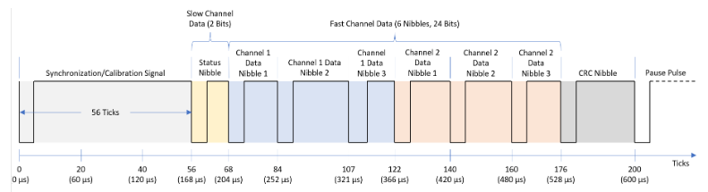

Each nibble begins with a five ticks logic low followed by a variable-width logic-high pulse. The high pulse width must be adjusted so that the nibble duration (between two consecutive falling-edge) range from 12 ticks (for a binary `0000`) to 27 ticks (for a binary `1111`), resulting in 16 different posibilities, shown in the figure below.

<br>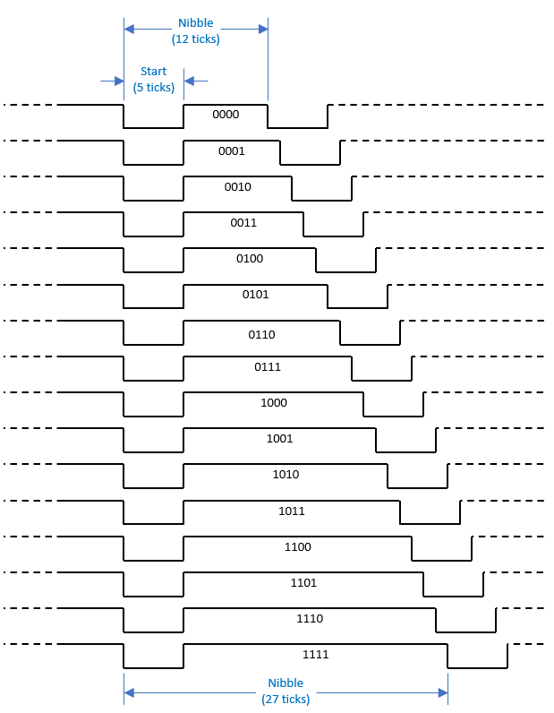

## Related Documentation

More details and code examples on the PIC18F56Q35 can be found at the following links:

- [PIC18F56Q35 Product Page](https://www.microchip.com/en-us/product/PIC18F56Q35?utm_source=GitHub&utm_medium=TextLink&utm_campaign=MCU8_PIC18-Q35&utm_content=pic18f56q35-clb-sent-interface-receive-vscode-mcc-github&utm_bu=MCU08)
- [PIC18F56Q35 Code Examples on MPLAB® Discover](https://mplab-discover.microchip.com/v2?dsl=PIC18F56Q35)
- [PIC18F56Q35 Code Examples on GitHub](https://github.com/microchip-pic-avr-examples/?q=PIC18F56Q35)

## Software Used

- [MPLAB® Tools for VS Code®](https://www.microchip.com/en-us/tools-resources/develop/mplab-tools-vs-code?utm_source=GitHub&utm_medium=TextLink&utm_campaign=MCU8_PIC18-Q35&utm_content=pic18f56q35-clb-sent-interface-receive-vscode-mcc-github&utm_bu=MCU08)
- [MPLAB® XC8 Compiler v4.00 or newer](https://www.microchip.com/en-us/tools-resources/develop/mplab-xc-compilers?utm_source=GitHub&utm_medium=TextLink&utm_campaign=MCU8_PIC18-Q35&utm_content=pic18f56q35-clb-sent-interface-receive-vscode-mcc-github&utm_bu=MCU08)
- [PIC18F-Q_DFP v1.31.492 or newer](https://packs.download.microchip.com/)

## Hardware Used

- The [PIC18F56Q35 Curiosity Nano Evaluation Kit](https://www.microchip.com/en-us/development-tool/EV55P36A?utm_source=GitHub&utm_medium=TextLink&utm_campaign=MCU8_PIC18-Q35&utm_content=pic18f56q35-clb-sent-interface-receive-vscode-mcc-github&utm_bu=MCU08) is used as a test platform:
  <br>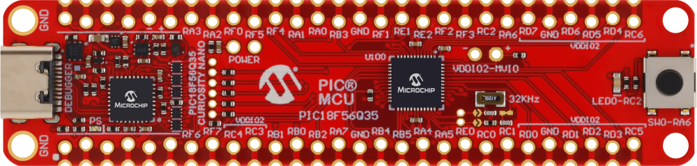

## Operation

To program the Curiosity Nano board with this VS Code project, follow the steps provided in the [How to Program the Curiosity Nano Board](#how-to-program-the-curiosity-nano-board) section.<br><br>

## Concept

The SENT input signal is routed to the CLB through PPS. In this configuration, the input signal is connected to pin RA1 through a comparator. The comparator output is then fed to the counter.

Timer2 provides the 3 µs timing reference used to measure the SENT pulse durations. The CLB detects the falling edges of the SENT signal and decodes each nibble based on the measured duration between consecutive falling edges.

The decoded 4-bit nibbles are stored in a register-based interface and read by the firmware. After receiving all eight nibbles, the firmware reconstructs the SENT frame, checks the CRC, extracts the Fast Channel data, and sends the result through EUSART2.

<br>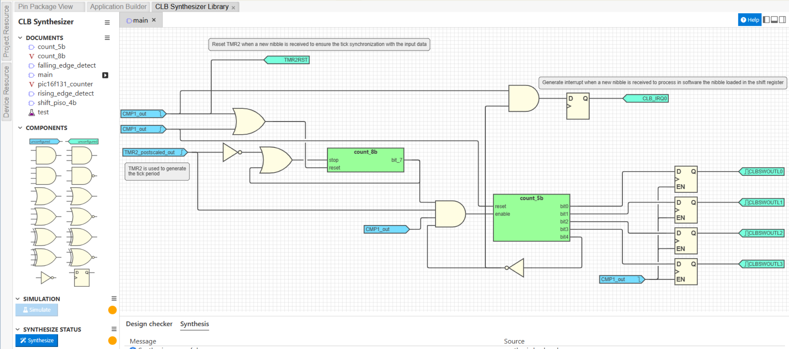

The following code snippet shows the main initialization and reception flow. The corresponding decoded SENT frames and UART output are shown in the [Demo section](#demo).

```c
    if(dataReady == true)
    {
        rxData = CLBSWOUTL;
        receivedBuffer[nibbleNo++] = rxData & 0x0F;

        INTERRUPT_GlobalInterruptDisable();
        dataReady = false;
        INTERRUPT_GlobalInterruptEnable();
        }
        
    if(nibbleNo >= 8)
    {
        nibbleNo = 0;
        transferInProgress = false;

        printf("0x");
        for(uint8_t i = 0; i < 4; i++)
        {
            printData = (uint8_t)(receivedBuffer[2*i+1] + (receivedBuffer[2*i]<<4));
            printf("%02X", printData);
            if(i == 0)
            {
                bit3 = ((receivedBuffer[0] & 0x08) ? 1 : 0);
                bit2 = ((receivedBuffer[0] & 0x04) ? 1 : 0);
            }
            if(i == 3)
                SMF_Processing(bit2, bit3);     
        }
        printf("\n\r");
    }
```

## Setup

The following peripheral and clock configurations are set up using the MPLAB Code Configurator (MCC) Melody for the PIC18F56Q35:

1. Clock Settings:
   - Clock Source: HFINTOSC
   - HF Internal Clock: 64_MHz
   - Clock Divider: 1
  <br>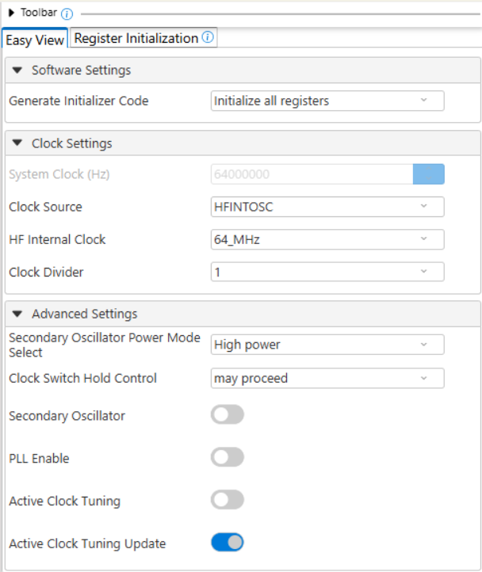

2. Interrupt Manager:
   - Enable Single ISR Execution per entry: Enabled 
  <br>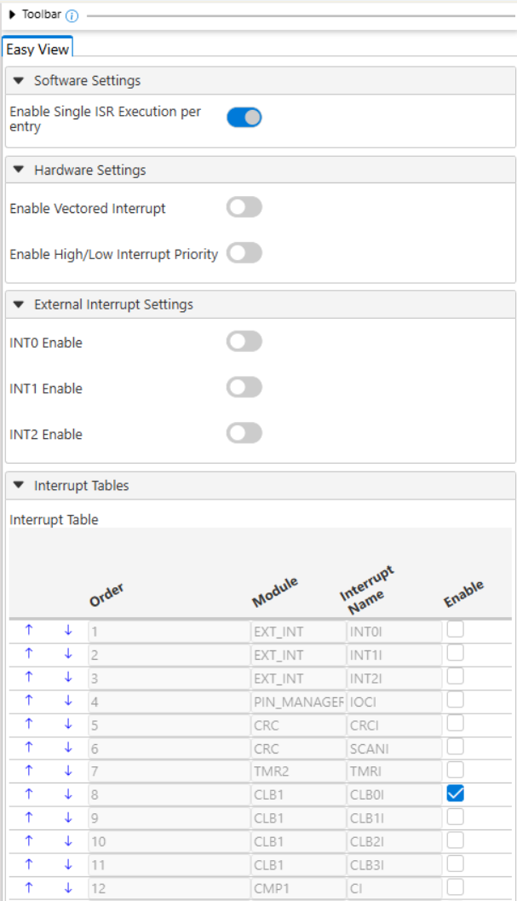

3. CLB Settings:
   - Clock Divider: 8
   - Clock Selection: HFINTOSC
  <br>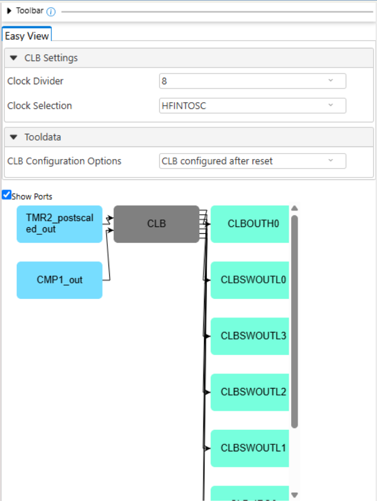

4. CLB1:
   - Enable CLB: Enabled
  <br>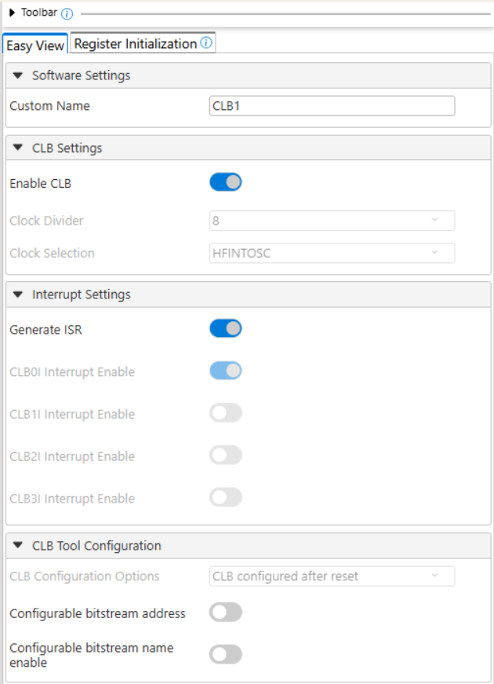

5. CMP1:
   - DAC Dependency Selector: DAC1
   - Enable Comparator: Enabled
   - Enable Synchronous Mode: Asynchronous
   - Enable Comparator Hysteresis: 30 mV Comparator Hysteresis
   - Positive Input Selection: DACOUT
   - Negative Input Selection: CIN1-
   - Output Polarity: Inverted
   - Comparator Speed: 30 ns hi_speed
  <br>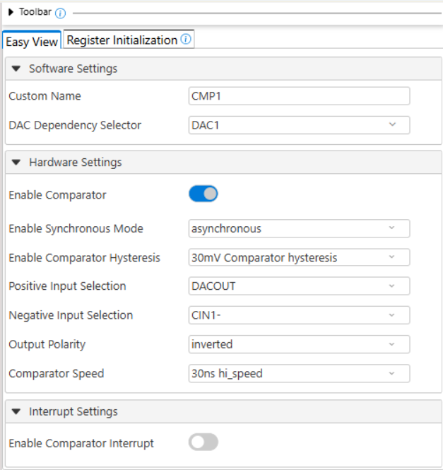

6. Timer2:
   - Timer Enable: Enabled
   - Control Mode: Roll Over Pulse
   - External Reset Source: T2INPPS (CLB output)
   - Start/Reset Option: Resets at rising TMR2_ers
   - Clock Source: HFINTOSC
   - Prescaler: 1:16
   - Postscaler: 1:1
   - Requested Period: 3 µs
  <br>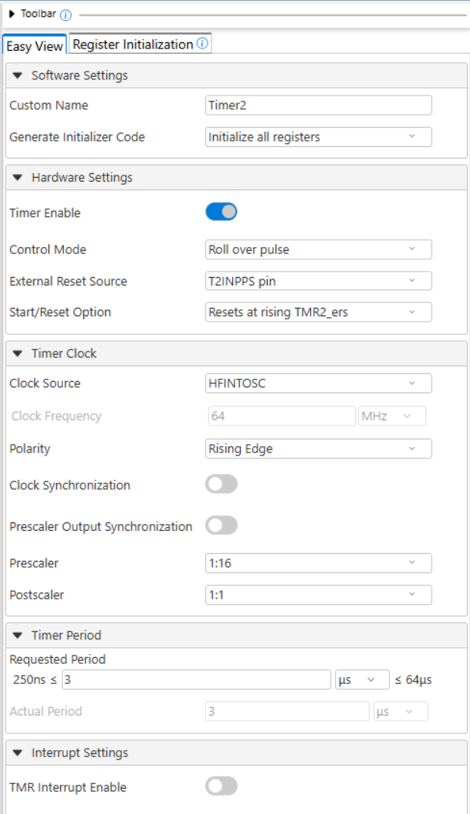

7. UART2:
   - Requested Baud Rate: 115200
   - Data Size: 8
   - Interrupt Driven: Disabled
   - Redirect STDIO to UART: Enabled
   - Enable Receive: Enabled
   - Enable Transmit: Enabled
   - Enable UART: Enabled
  <br>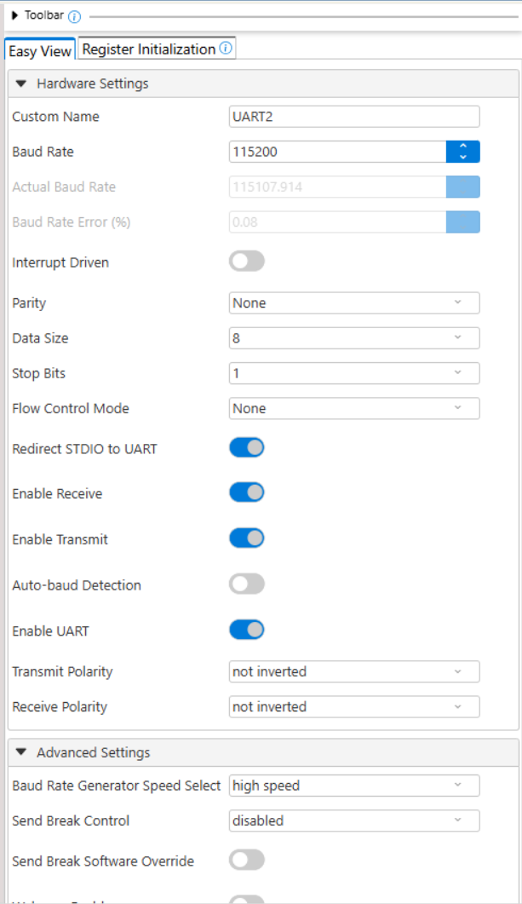

8. Pin Grid View and Pins:
    - C1INx-: RA1 (SENT Input)
    - UART2 TX2: RB4 (Data from terminal)
  <br>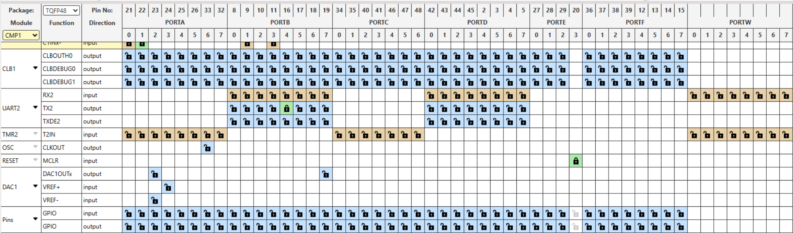
  <br>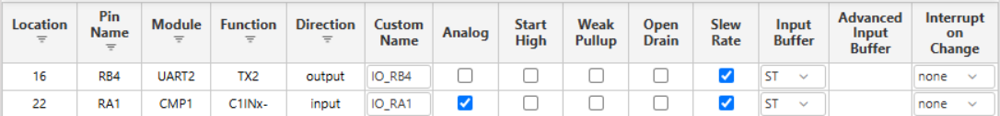

## Demo

The receiver monitors the SENT signal on pin `RA1`. When a valid SENT frame is received, it decodes the data nibbles from the fast channel and, if enabled, from the slow channel. The received CRC nibble is also extracted and used to validate the frame.

The slow-channel message format is configured in `SENT_Receive.h` using the `SLOW_MESSAGE_MODE` macro:
- `0`: Short Serial Message Format
- `1`: Enhanced Serial Message Format
- `-1`:  Disable slow-channel message decoding

**Figure 1.** Short Serial Message Format
<br>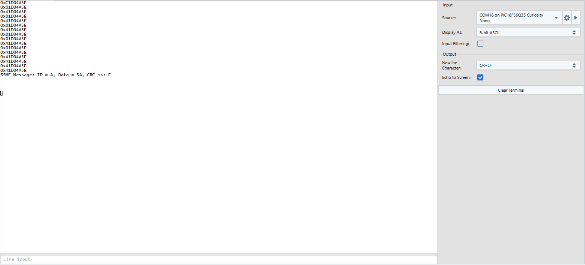

**Figure 2.** Enhanced Serial Message Format
<br>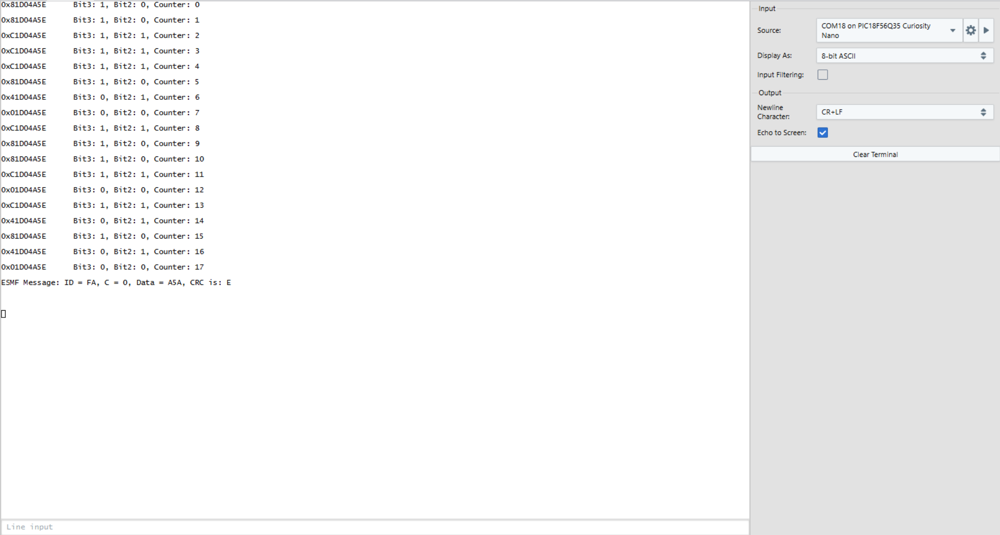

## Summary

This example demonstrates the reception and decoding of a SENT frame. The CLB is used to decode the received nibbles. The decoded data is stored in registers, reconstructed in software, checked using the CRC nibble and displayed on a serial terminal through the EUSART2 peripheral.

## How to Program the Curiosity Nano Board

This section demonstrates how to use VS Code to program a PIC® device with an `Example_Project`. This is applicable to other projects.

1.  Connect the board to the PC.

2.  Open the `Example_Project` project in VS Code.

3.  Clean and build the `Example_Project` project.
    <br>Press `Ctrl+Shift+P` on the keyboard and select `MPLAB CMake: Clean and build`.
    <br>
    <br>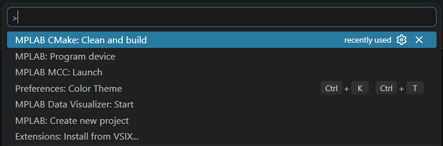

4. Select the desired configuration.
    <br>
    <br>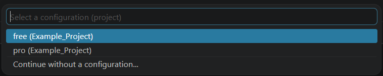

5. Program the project to the board.
    <br>Press `Ctrl+Shift+P` on the keyboard and select `MPLAB: Program device`.
    <br>
    <br>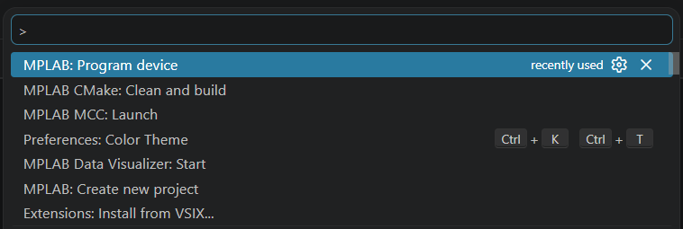

6. Select the desired configuration.
    <br>
    <br>

7.  Select `PIC18F56Q35 Curiosity Nano` in the Connected Hardware Tool section of the project settings.
    <br>
    <br>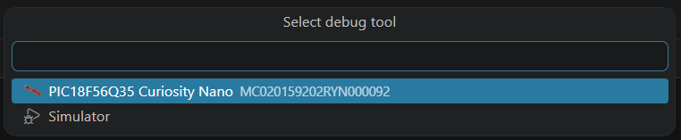
<br>


## Troubleshooting Guide

In case the project cannot be compiled due to ```VS Code``` or ```XC8``` not being able to support long paths, follow these steps:

1. In the VS Code PowerShell terminal, map the project folder to a temporary drive letter (for example, X:): `subst X: "C:\Users\Path to project"`.
<br>
<br>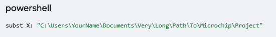

2. Open that new space instantly in VS Code by running `code X:`.
<br>
<br>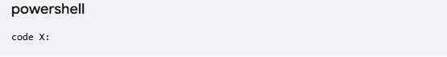

3. Follow the steps provided in the [How to Program the Curiosity Nano Board](#how-to-program-the-curiosity-nano-board) section.

---

## Menu

- [Back to Top](#sent-protocol-based-on-clb-using-the-pic18f56q35-microcontroller-with-mcc-melody)
- [Back to Related Documentation](#related-documentation)
- [Back to Software Used](#software-used)
- [Back to Hardware Used](#hardware-used)
- [Back to Operation](#operation)
- [Back to Concept](#concept)
- [Back to Setup](#setup)
- [Back to Demo](#demo)
- [Back to Summary](#summary)
- [Back to How to Program the Curiosity Nano Board](#how-to-program-the-curiosity-nano-board)
- [Troubleshooting Guide](#troubleshooting-guide)
